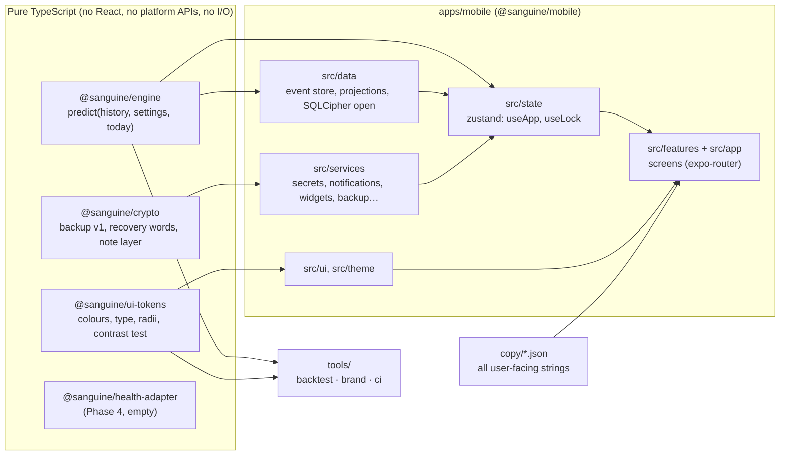
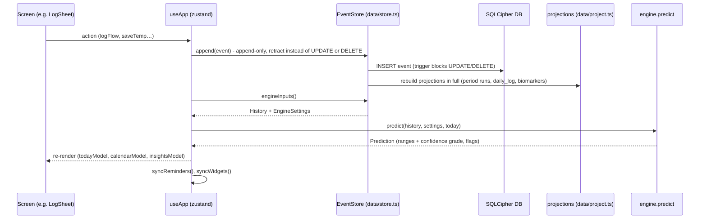
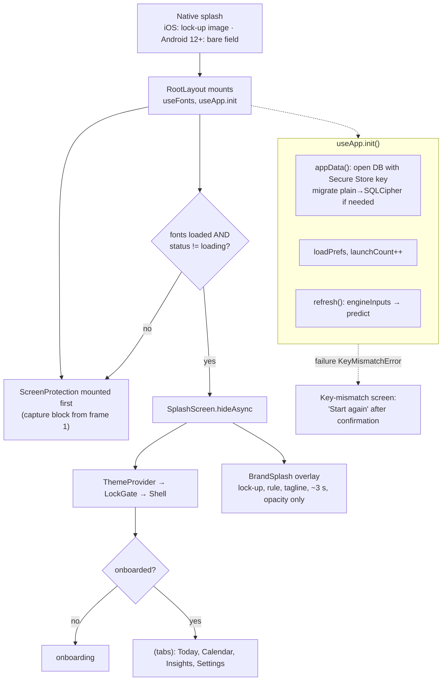
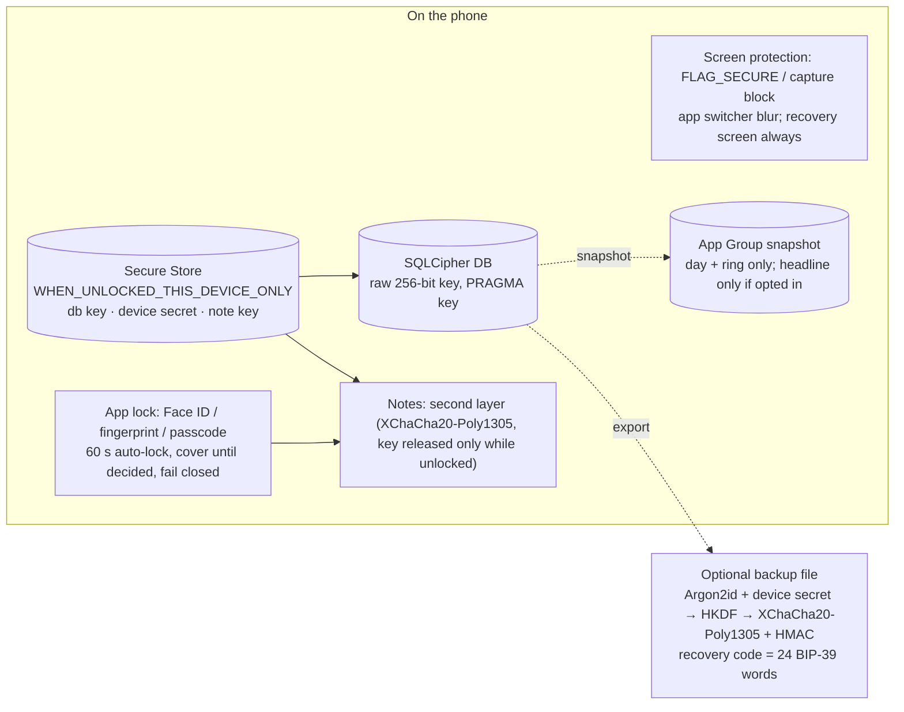
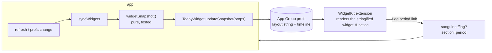

# Architecture

Sanguine is an on-device, free cycle tracker: React Native + Expo (SDK 57, dev client), TypeScript 7, pnpm workspaces.
No network calls except the optional encrypted backup upload (Phase 3, P3-7). The prediction engine is a pure function.

## 1. Packages and who may import whom

Rules the tests enforce: the engine has **no runtime dependencies** and no `Date.now()`/randomness (`purity.test.ts`); symptoms
never reach `predict`; `copy/*.json` passes the forbidden-word test; `tools/ci/deny-list.test.ts` fails if an analytics,
crash-reporting, ad or attribution package appears in `apps/mobile/package.json`.

## 2. Data flow: from a tap to a prediction

Key invariants: events are immutable (a correction is a retract event plus a new event); `period.start { merge: true }` joins
runs ≤ 7 days apart; every prediction is a **range with a confidence grade** (never one highlighted "fertile day"); symptoms are
stored and shown but never change a prediction.

## 3. Boot sequence

## 4. Security layers

- DB open and migration: `data/cipher.ts` (pure orchestration, tested with a fake file system) and `data/expoDatabase.ts`.
  A crash between removing the plain file and renaming the encrypted one is finished on the next open.
- Android Auto Backup is off and the key is device-bound, so a restored phone has the file but not the key: the app shows
  "Your data on this phone cannot be opened" and offers a confirmed fresh start (the backup + recovery code is the way back).
- "Delete everything" (`data/wipe.ts`): secure_delete, drop, WAL checkpoint, VACUUM, delete secrets, sweep temp files,
  blank the widget, reset the discreet icon.

## 5. Widget and splash flows

- The widget layout is a function marked `'widget'`; the Babel preset stringifies it, and **only if `expo-widgets` was
  resolvable when Metro started** (restart Metro with `--clear` after installing it). Inside it: no hooks, no module-scope
  references, only `@expo/ui/swift-ui`.
- Lock-screen families show only the app name unless "Show details in widgets" is on (they are readable while locked).
- Android widget: deferred (P3-5b); expo-widgets' Glance renderer is a placeholder in SDK 57.

Splash: tagline = `taglineFor(launchCount)` (six lines in `copy/en-AU.json` `app.taglines`, never the same twice in a
row, none in teen mode). Android 12+ masks the native splash image to a circle, so the native splash there is the bare field
and the JS splash fades the lock-up in.

## 6. Where things are

| Concern | Path |
| --- | --- |
| Engine modules (NIG cycle model, luteal, BBT, LH, mucus, cervix, combine, life-state gates, flags) | `packages/engine/src` |
| Golden fixtures A–I and property tests | `packages/engine/src/fixtures*.ts`, `properties.test.ts` |
| Event store, projections, export/import, backup | `apps/mobile/src/data` |
| Screens (expo-router file routes) | `apps/mobile/src/app` |
| Feature logic and components | `apps/mobile/src/features/<area>` |
| Strings and fixed wording | `copy/en-AU.json`, `copy/legal.en-AU.json`, `copy/glossary.en-AU.json`, `copy/symptoms.json` |
| Dev-only seed route for tests | `apps/mobile/src/app/dev/seed.tsx` (`/dev/seed?scenario=…&theme=…&lock=1&resetSecrets=1&protect=1`) |
| Brand build | `tools/brand/build.ts` (assets), `docs/brand.html` |
| CI-style tests | `tools/ci` (deny-list, SOUP currency, engine hash) |
| Backtest and acceptance | `tools/backtest` |
